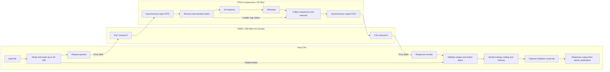
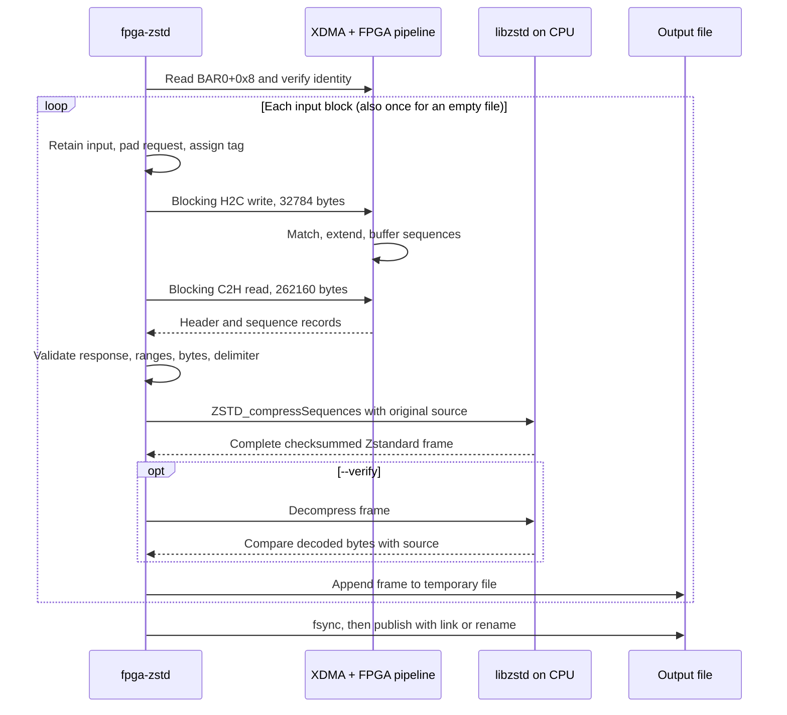

# FPGA-assisted Zstandard architecture

The delivered accelerator offloads **LZ77 match finding and match extension**
to a YPCB-00338-1P1 PCIe FPGA card. The CPU retains each input block, validates
the FPGA's match descriptions, and supplies those sequences to libzstd for
Huffman/FSE entropy coding, checksums, and Zstandard framing. The output is a
standard `.zst` file that an ordinary software decoder can decompress.

The FPGA is `xc7k480tffg1156-2` and the implemented compression logic operates
at **50 MHz**. The design uses Vitis Data Compression **L1** functions, Xilinx
2026.1 HLS/Vivado, and XDMA over PCIe Gen2 x8. It uses on-chip memory and
streams; there is no external DDR controller, L2/L3 accelerator, XRT runtime,
or xclbin in this implementation.

For build and programming instructions see [HOWTO.md](HOWTO.md), for command
usage see [README.md](README.md), and for the development/validation history
see [WORKFLOW.md](WORKFLOW.md).

## 1. Partition and data path



Zstandard represents data using literals and matches against earlier bytes.
A sequence specifies a run of literal bytes followed by a match: its length
and backward distance. Finding useful matches is the part performed here in
hardware. The CPU already has the original bytes, so the FPGA returns only
lengths and offsets, avoiding any need to return literal data separately.

| Responsibility | Implementation |
| --- | --- |
| File I/O, block boundaries, device selection, output publication | [host/fpga_zstd.cpp](host/fpga_zstd.cpp) |
| LZ77 search and extension | Vitis L1 `lzCompress` and `lzBooster`, wrapped by [hls/zstd_accel.cpp](hls/zstd_accel.cpp) |
| Sequence validation and conversion to a Zstandard frame | [host/sequence_encoder.hpp](host/sequence_encoder.hpp), system libzstd |
| PCIe transport and host DMA | XDMA IP and the pinned Linux XDMA driver |
| Clock crossing and board integration | [scripts/create_design.tcl](scripts/create_design.tcl), [constraints/board.xdc](constraints/board.xdc) |

The same two LZ77 stages are used by upstream L1 Zstandard's `getLitSequences`.
The complete L1 Zstandard encoder was investigated but did not pass the tested
C-model cases for the pinned configuration. Its diagnostic evidence is
described in [WORKFLOW.md](WORKFLOW.md). The delivered CPU encoder consumes
FPGA-supplied sequences through `ZSTD_compressSequences`; it does not invoke a
replacement match finder. Consequently, this is a hardware-assisted encoder
with CPU entropy coding, rather than an FPGA that directly emits `.zst` bytes.

## 2. FPGA pipeline

The HLS top level is `zstd_accel`. Both data interfaces are
`ap_axiu<128, 0, 0, 0>` AXI Streams, with no ID, destination, or user sideband
fields. The control protocol is `ap_ctrl_hs`; the body uses `DATAFLOW` to
connect four processes:

```text
receive → lzCompress → lzBooster → transmit
    └──────────── metadata ──────────┘
```

The byte FIFO and the two token FIFOs each have depth 32; metadata has depth 2.
All stages obey blocking stream reads/writes, so backpressure propagates
through the pipeline. The packaged IP exposes stream ports named `input_r`
and `output_r`.

### Receive and short-input handling

`receive` consumes a 16-byte header and exactly 32,768 payload bytes for every
request. It checks the request signature and length, passes length/tag/status
to `transmit`, and serializes valid payload bytes into an 8-bit L1 stream.
It consumes padding too, keeping the next request aligned. Request framing
comes from fixed beat counts; this wrapper does not use input `TLAST` or
`TKEEP` to infer the packet length.

For input longer than 128 bytes, valid bytes have strobe 1, followed by a
zero-strobe block terminator and a zero-strobe file terminator. For lengths
0 through 128, the wrapper consumes the full request but sends only the
end-of-file indication to the L1 stages. `transmit` then emits a single
literal-only delimiter whose literal length equals the input size. This
avoids the upstream matcher's minimum-lookahead underflow. Empty files still
use the FPGA transaction and produce a valid empty software-encoded frame.

### Match finder

The exact call is:

```cpp
xf::compression::lzCompress<32768, uint32_t, 6, 3, 32768>(bytes, matches);
```

The selected stream overload in
[lz_compress.hpp](vendor/Vitis_Libraries/data_compression/L1/include/hw/lz_compress.hpp)
has these settings, including template defaults:

| Parameter | Value / meaning |
| --- | --- |
| Maximum input block | 32,768 bytes |
| Initial comparison window | 6 bytes |
| Minimum match length | 3 bytes |
| Maximum offset limit | 32,768; the actual-distance comparison is strictly less than this limit |
| Dictionary entries | 4096 hashed entries |
| Candidates per entry | 6 |
| Position storage | 24 bits per candidate |
| Minimum stored offset | 1 on the offset-minus-one representation, so initial match distance is at least 2 |
| Tail handling | Last 64 input bytes are literals |

Each candidate stores a six-byte comparison window and a position. The matcher
hashes the current window, compares candidates, selects the longest accepted
match, and updates the dictionary. The selected upstream code also rejects a
three-byte match when its offset-minus-one exceeds 4096.

`AVOID_STATIC_MODE` makes the dictionary reset state local to the invocation,
so every request begins with a fresh dictionary. There is no match history
between requests. `DISABLE_DEPENDENCE` disables upstream dependence pragmas
that would otherwise assert away relevant loop-carried hazards.

### Match extension

The next call is:

```cpp
xf::compression::lzBooster<255>(matches, boosted);
```

This function is defined in
[lz_optional.hpp](vendor/Vitis_Libraries/data_compression/L1/include/hw/lz_optional.hpp).
It extends matches using buffered input history and suppresses tokens covered
by an extended match. Maximum match length is 255 bytes. Its default block
size is 32,768, but its **history window is 16,384 bytes**. Matches beyond that
history window can still come from the initial matcher; extension applies
within the booster's available history. The trailing 64-byte literal handling
is retained.

The internal 32-bit token format is:

| Bits | Meaning |
| --- | --- |
| 7:0 | Literal byte |
| 15:8 | Match length; zero identifies a literal token |
| 31:16 | Backward offset minus one |

### Sequence collection and response

`transmit` counts consecutive literal tokens. On a match, it emits a record
containing the actual backward distance (token offset plus one), accumulated
literal length, and match length. It tracks total consumed input bytes, then
adds an explicit final delimiter with the trailing literal count.

Records are buffered before sending the response header so the count is known.
The declared buffer is `ap_uint<128> buffer[16384]`, bound to single-port BRAM:
256 KiB of logical record storage. Synthesis can remove constant/unused bits,
so this declaration is not a separate measurement of physical BRAM usage.
The response always sends all 16,384 record slots, zero-filling unused slots.
Each output beat has all `TKEEP` and `TSTRB` bits set; only the last beat of the
fixed response asserts `TLAST`.

Each match consumes at least three bytes. Even the conservative maximum of
`floor(32768 / 3) + 1 = 10923` records, including the final delimiter, fits
within 16,384 slots. The wrapper nevertheless reports overflow and checks
whether the token lengths consumed exactly the specified input size.

### Memory and portability

All working storage is on-chip: dictionary, booster history, internal stream
FIFOs, record buffer, and asynchronous DMA FIFOs. Kintex-7 has no UltraRAM.
[scripts/prepare_library.py](scripts/prepare_library.py) therefore copies the
pinned L1 headers and converts UltraRAM bindings to BRAM in
`build/vitis_include`. It handles both newer `BIND_STORAGE` directives and the
older dictionary `RESOURCE ... XPM_MEMORY uram` directive. The original library
checkout and the earlier full-core investigation patches are not modified or
applied by this preparation step.

## 3. PCIe integration and control plane

The endpoint is configured as follows:

| Property | Configuration |
| --- | --- |
| PCIe link | Gen2, 5 GT/s, x8 |
| Vendor/device | `10ee:7021` |
| Class | `0580` |
| Hard-block placement | `X0Y0` |
| DMA interface | 128-bit AXI Stream |
| DMA channels | One H2C and one C2H |
| Control access | XDMA AXI-Lite master plus JTAG AXI master |
| Application interrupt | `usr_irq_req` tied low |

The host opens `PREFIX_h2c_0`, `PREFIX_c2h_0`, and `PREFIX_user`, with default
`PREFIX=/dev/xdma0`. The driver handles DMA descriptors and PCIe transfers;
the application uses blocking `write()` and `read()` calls. The setup helper
loads the pinned driver with `poll_mode=1`. There is no application completion
interrupt protocol; readiness/completion is observed through those driver calls.

The control interconnect has two masters and two slaves. XDMA's control side
crosses from the 250 MHz domain; JTAG AXI, GPIO, and I2C operate at 50 MHz.
The address assignments are identical for the XDMA and JTAG masters:

| Base / offset | Function |
| --- | --- |
| `0x00000000`, 64 KiB window | AXI GPIO |
| GPIO offset `0x0` | Channel 1 data: three board LEDs |
| GPIO offset `0x8` | Channel 2 input: constant protocol identity `0x5a535432` |
| `0x00010000`, 64 KiB window | AXI IIC for LM73, configured for 100 kHz |

The CLI maps 4096 bytes of the XDMA user aperture and reads BAR0 offset `0x8`
before sending data. A loopback or unrelated bitstream fails this identity
check. The HLS block has no host-visible AXI-Lite command/status register bank:
`ap_start` is tied high and the next invocation begins when its HLS control
handshake permits, waiting on the next input header as necessary.

[rtl/board_status.v](rtl/board_status.v) synchronizes PCIe state and generates
a peripheral startup reset. Its computed `status` output is not the identity
register and is not mapped by this design. LEDs are controlled by GPIO; they
are not automatic compression-progress indicators. The compression CLI does
not access the LEDs or temperature peripheral.

## 4. Clocks, reset, and backpressure

| Clock | Frequency | Use |
| --- | ---: | --- |
| Board `sys_clk`, pin AA28 | **50 MHz** | HLS compressor, peripheral/control domain, core-side stream FIFO interfaces |
| XDMA `axi_aclk` | 250 MHz | DMA streams and XDMA-side control/FIFO interfaces |
| PCIe differential reference, J8/J7 | 100 MHz | PCIe reference clock |
| PCIe internal `userclk1` | 500 MHz | Internal PCIe logic; final recorded limiting timing domain |
| HLS synthesis target | 100 MHz / 10 ns | Scheduling target only |

The constraints specify a 20 ns period for the board clock and 10 ns for the
PCIe reference. HLS uses a 10 ns target with 12.5% uncertainty. Its reported
123.10 MHz estimated maximum is a synthesis estimate, not a programmed
operating frequency. The actual compression clock is the connected 50 MHz
board oscillator.

Each stream direction has an asynchronous AXI Stream FIFO with 1024 entries
of 16 data bytes: **16 KiB payload capacity per direction**, with `TKEEP` and
`TLAST` support. These FIFOs absorb rate differences, implement the data clock
crossing, and propagate backpressure. They are smaller than a complete request
or response; packets move through them incrementally.

Reset wiring follows the clock domains:

- XDMA's active-low `axi_aresetn` resets the input FIFO's source side and the
  XDMA-side control interface, and feeds `proc_sys_reset/ext_reset_in`.
- `proc_sys_reset` synchronizes reset release to 50 MHz. Its active-low
  peripheral reset drives HLS `ap_rst_n` and the output FIFO's source reset.
- The unused auxiliary reset is active-low and tied **high**; debug reset is
  tied low and `dcm_locked` high. The Tcl script checks the external/auxiliary
  reset polarities after block-design validation.
- The retained GPIO/I2C/JTAG control peripherals use `board_status/resetn`,
  released after its eight-bit startup counter saturates. This is separate
  from the XDMA-derived compressor reset.

The host keeps one transaction outstanding. It completes H2C before starting
C2H. The FPGA consumes the full padded request before finalizing the response,
and buffers the sequence records before transmission. Output stalls therefore
do not require an unread portion of the same request to be sent concurrently.
If C2H is not ready, the response waits in the output FIFO and HLS pipeline
until the driver reads it. RTL tests exercise this backpressure behavior.

## 5. Version 2 wire protocol

All fields are little-endian unsigned 32-bit words. A beat is 128 bits / 16
bytes. The host explicitly packs and unpacks byte order rather than sending
C++ structures with implicit padding.

### Request: 32,784 bytes, 2049 beats

| Byte offset | Size | Meaning |
| --- | ---: | --- |
| 0 | 4 | Request signature `0x3254535a` |
| 4 | 4 | Actual input size, 0 through 32,768 |
| 8 | 4 | Request tag; host block counter truncated to 32 bits |
| 12 | 4 | Reserved, sent as zero |
| 16 | 32,768 | Input bytes followed by zero padding |

The wrapper validates signature and size. For an invalid header it sets status
1, treats the effective size as zero, and still consumes the entire fixed
payload. It does not validate padding or the reserved word. A truncated DMA
request can leave the receive state waiting for the remaining beats.

### Response: 262,160 bytes, 16,385 beats

| Byte offset | Size | Meaning |
| --- | ---: | --- |
| 0 | 4 | Response signature `0x3251535a` |
| 4 | 4 | Valid record count, including the final delimiter |
| 8 | 4 | Echoed request tag |
| 12 | 4 | Status |
| 16 | 262,144 | 16,384 record slots; unused slots are zero |

Each record occupies one beat:

| Record byte offset | Meaning |
| --- | --- |
| 0 | Actual backward offset, not offset-minus-one |
| 4 | Literal length preceding the match |
| 8 | Match length |
| 12 | Reserved, zero |

The last valid record has offset 0 and match length 0. Its literal length is
the number of trailing literals, which may be zero. A literal-only block has
one record: `{offset=0, literal_length=input_size, match_length=0, reserved=0}`.
The current host ignores reserved words and unused slots; it validates the
header and all valid sequence fields.

| Status | Meaning |
| --- | --- |
| 0 | Success |
| 1 | Invalid request signature or length |
| 2 | Sequence-buffer overflow |
| 3 | Token-consumed byte count differs from input size |

Status is a single code, not a bitmask. The host rejects any nonzero status,
a zero/excessive count, an unexpected signature, or a mismatched tag. Fixed
request and response sizes remain the same for empty and full blocks alike.

## 6. CPU transaction and Zstandard encoding

At startup the utility checks the input/output paths, opens the device nodes,
acquires a nonblocking exclusive advisory `flock` on H2C, and verifies the FPGA
identity. It creates a temporary output beside the intended destination,
allocates 4096-byte-aligned DMA buffers, and creates a reusable Zstandard
compression context. The lock serializes cooperating utility instances; it
cannot prevent an unrelated program from ignoring the lock and using XDMA.



Each DMA syscall must transfer the complete expected byte count. Interrupted
syscalls are retried; short transfers or other errors fail the invocation.
There is no attempt to continue from a partial packet. The pinned driver's
H2C and C2H timeout defaults are 10 seconds.

For each response the host builds `ZSTD_Sequence` entries with `offset`,
`litLength`, `matchLength`, and `rep=0`. Before encoding, the shared encoder:

1. Checks that each literal run fits in the remaining source.
2. Checks non-final matches have length at least three, fit in the remaining
   source, and reference a positive distance within already-consumed input.
3. Compares the reported match bytes directly against the original source,
   including valid overlapping LZ77 matches.
4. Requires the last record to have zero offset/match length and to bring the
   consumed count exactly to the source length.

The Zstandard context is configured with:

| Setting | Value |
| --- | --- |
| Compression level | 3 |
| Minimum match | 3 |
| Window log | 15, corresponding to 32 KiB |
| Content checksum | Enabled |
| Block delimiters | Explicit |
| libzstd sequence validation | Enabled |

`ZSTD_compressSequences` receives the checked sequences and original source.
It takes literal bytes from that source, encodes the literals and sequence
symbols, and creates the frame. libzstd selects valid block representations,
including raw or RLE forms where appropriate. The compression-level setting
does not cause this utility to run a CPU match-finding pass.

The source defines `ZSTD_STATIC_LINKING_ONLY` to expose the advanced API
declarations in `zstd.h`. The Makefile links with `-lzstd`; the validated
executable dynamically links the system library. The macro does not mean the
executable is statically linked. Version 1.5.5 was tested; changing this advanced
API dependency requires validation.

Each input block creates one independent frame with a checksum. Reusing the
CPU context does not carry match history across frames. The final file is the
concatenation of those frames, supported by standard `zstd` decoding. This
bounds memory regardless of input-file length, at the cost of per-frame
overhead and reduced opportunities to match across 32 KiB boundaries.

`--verify` additionally decompresses each frame and compares every byte before
writing it. After all frames are written, `fsync()` flushes the temporary file.
Default publication uses `link()` so an existing destination cannot be
overwritten; `-f` uses `rename()` to replace it atomically. Input/output inode
aliases are rejected. Caught failures remove the temporary file and preserve
the prior destination. Abrupt termination may leave a temporary file, and
atomic replacement is not a promise of directory-entry durability across a
power failure; the code does not fsync the parent directory.

An identity, DMA, status, sequence, or software-verification error stops the
operation. There is no CPU match-finding fallback. After interrupted/failed
DMA, reprogramming resets queued stream data before another run.

## 7. Resource use, validation, and performance

The HLS estimate for the core was 180 BRAM18K units, 7287 LUTs, 3501 registers,
and no DSP/URAM. The final routed **whole design**, including PCIe, clock
crossings, interconnect, and peripherals, reported:

| Resource / check | Recorded result |
| --- | ---: |
| LUTs | 21,377 / 7.16% |
| Registers | 24,634 / 4.12% |
| BRAM36K tiles | 118 / 12.36% |
| DSPs | 0 |
| Worst setup slack | +0.025 ns |
| Worst hold slack | +0.009 ns |
| Minimum reported bus-skew slack | +3.342 ns |

HLS and Vivado resource figures cover different scopes and use different BRAM
units. Final timing passed after Explore routing and AggressiveExplore
post-route optimization. DRC had no errors; vendor IP warnings remain in the
saved reports. See [timing](reports/timing_summary.rpt),
[utilization](reports/utilization.rpt), [bus skew](reports/bus_skew.rpt),
[DRC](reports/drc.rpt), and [methodology](reports/methodology.rpt).

Validation passed 89 C-model cases, 13 RTL cases with stream stalls, and 57
physical-board file cases totaling 3,075,210 input bytes. The hardware cases
used both libzstd verification and an independent `zstd` CLI decode with exact
byte comparison. Additional CLI regressions cover overwrite and failure
handling. Provenance and report locations are recorded in
[WORKFLOW.md](WORKFLOW.md).

Selected results from the original hardware run:

| Input | Input bytes | `.zst` bytes | Output / input | Reduction |
| --- | ---: | ---: | ---: | ---: |
| `PROMPT.md` | 623 | 382 | 61.32% | 38.68% |
| Vitis Zstandard source | 44,712 | 11,727 | 26.23% | 73.77% |
| Synthetic repeated text | 1,048,576 | 17,373 | 1.66% | 98.34% |
| Random bytes | 1,048,576 | 1,049,024 | 100.04% | −0.04% |

The source example used 4359 FPGA matches covering 41,437 input bytes. The
synthetic text run measured 23.48 MiB/s and random data 17.69 MiB/s, including
verification and output flush. These are individual runs, with no CPU-only
baseline; they do not demonstrate speedup. The CLI timer starts after initial
file/device setup and allocation and ends after output publication. The test
suite's outer per-case timer additionally includes process invocation and its
separate software decode, so those timings are not interchangeable.

The current throughput has several structural limits:

- A full 32 KiB block transfers 32,784 bytes H2C and **262,160 bytes C2H**:
  294,944 bytes total, about nine times the input before PCIe overhead.
  The C2H response alone is about eight times the input, even when few matches
  are present. This cost is independent of the final `.zst` size.
- The receive stage serializes valid input bytes and the L1 pipeline works at
  50 MHz. The 128-bit DMA port is a transport interface, not a promise of
  sixteen input bytes compressed each clock.
- Dictionary initialization and fixed padding recur for every request,
  including short blocks. The response buffer and fixed output drain add
  per-block latency.
- One transaction is outstanding, and the CPU performs sequence checking,
  entropy coding, optional verification, and file output between transactions.
- Independent 32 KiB frames and the matcher's search/extension limits can
  reduce compression compared with a software encoder using longer history.

Possible future changes include compact or variable-length responses,
overlapping DMA with CPU encoding, and larger or parallel match pipelines.
Those would require revised framing/ownership rules and fresh validation;
they are not capabilities of the delivered implementation.
